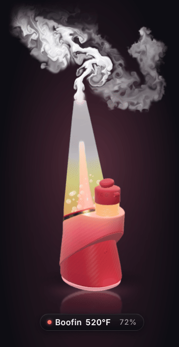
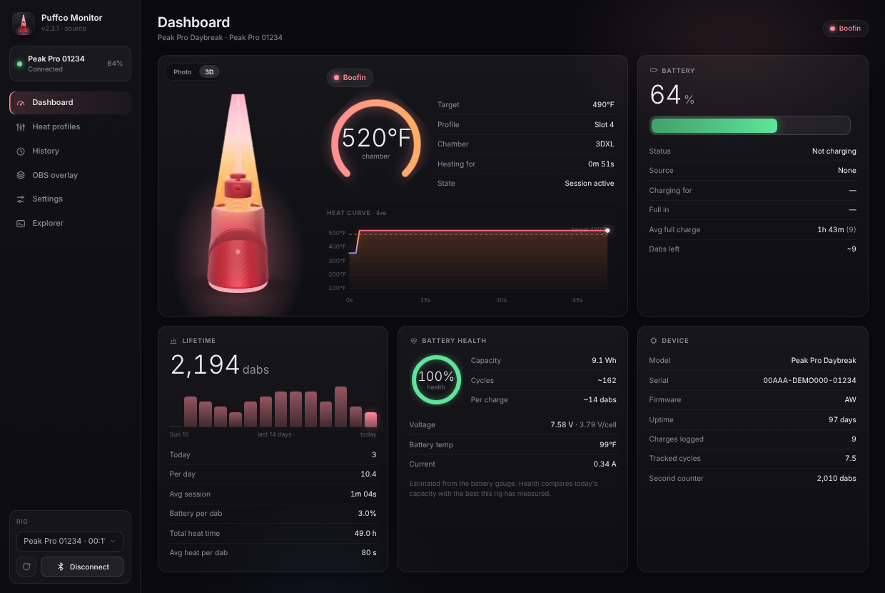
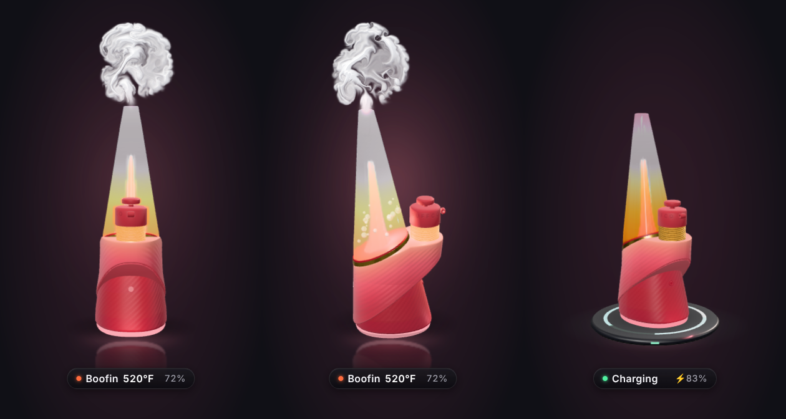
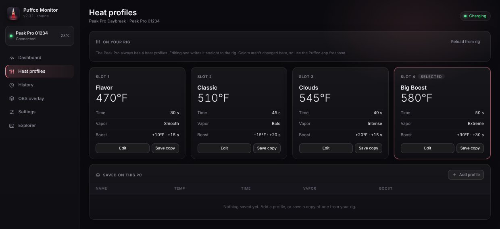
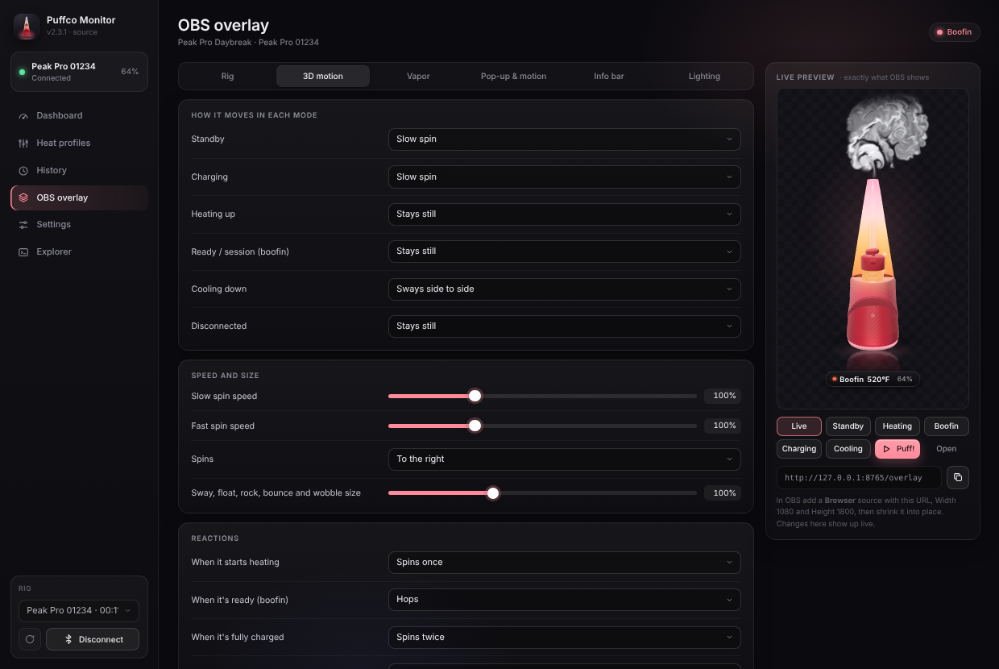

<p align="center">
  
</p>

<h1 align="center">Puffco Monitor</h1>

<p align="center">
  <b>Your Puffco Peak Pro on your PC and on stream.</b><br>
  A Windows app that reads the rig over Bluetooth, plus an OBS overlay that heats up, glows and smokes along with the real one.
</p>

<p align="center">
  <a href="../../releases/latest"></a>
  
  
</p>

<p align="center">
  <a href="#features">Features</a> ·
  <a href="#get-started">Get started</a> ·
  <a href="#add-it-to-obs">Add it to OBS</a> ·
  <a href="#the-3d-model">The 3D model</a> ·
  <a href="#faq">FAQ</a>
</p>

<br>



## Features

<table>
<tr>
<td width="50%" valign="top">

### On your PC

- **Live dashboard:** chamber temperature, target, heat profile, a live heat curve, and what the rig is doing right now. Show the rig as a photo or as the animated 3D model.
- **Heat profiles:** see and edit all 4 profiles on the rig (name, temperature, time, vapor and boost), and keep your own library of profiles on your PC.
- **Battery:** charge level, charger type, how long it's been charging, when it'll be full, and roughly how many dabs are left.
- **Battery health:** estimated capacity, charge cycles, dabs per charge, voltage and temperature.
- **History:** every charge and session, lifetime dabs and a 14-day chart.
- **Stays out of the way:** lives in the system tray, reconnects on its own, starts with Windows if you want, and can notify you when the rig is ready, full or low.

</td>
<td width="50%" valign="top">

### On stream

- **Your rig as an OBS overlay** that shows standby, heating up and your session, with an info bar for temperature and battery.
- **Smoke with a real rhythm:** a fluid-simulated cloud on each inhale, then a clear exhale and a pause, all timed the way you set it.
- **Two styles:** a photo of your edition, or an HD 3D model that spins, hops, flips and reacts as things happen.
- **Pops up when something changes,** swoops in, and stays up through the whole heat-up and session. The info bar can stay on screen by itself.
- **Charging pad, glows, bubbles and a carb cap that moves.**
- **Everything is adjustable** with a live preview: sizes, timings, colors, wording, animations and when it hides.

</td>
</tr>
</table>

<p align="center">
  
</p>

<table>
<tr>
<td width="50%"></td>
<td width="50%"></td>
</tr>
<tr>
<td align="center"><sub><b>Heat profiles</b>: edit what's on the rig, keep copies on your PC</sub></td>
<td align="center"><sub><b>3D motion</b>: pick how it moves and reacts, with a live preview</sub></td>
</tr>
</table>

## Get started

1. **Download** `PuffcoMonitor.exe` from the [latest release](../../releases/latest) and put it in a folder of its own. It keeps its data next to itself.
2. **Run it.** The app isn't signed, so Windows SmartScreen may warn you. Click **More info**, then **Run anyway**.
3. **Close the Puffco phone app,** or turn off your phone's Bluetooth. The rig only takes one connection at a time.
4. **Click Scan,** pick your rig, then **Connect.**

Closing the window keeps it running in the tray. Right-click the tray icon to connect, copy the overlay link, turn **Start with Windows** on or off, or quit.

## Add it to OBS

1. Add a **Browser** source.
2. Set the URL to `http://127.0.0.1:8765/overlay`.
3. Set the width to **1080** and the height to **1800**, then shrink it into place. It renders at twice the size so it stays sharp.

Puffco Monitor has to be running for the overlay to move. Anything you change on the app's **OBS overlay** page shows up live.

## The 3D model

On the **OBS overlay** page, set **Rig → Style** to **3D model**. The **3D motion** tab then lets you pick:

| Setting | Your options |
|---|---|
| **How it moves in each mode** | still, slow spin, fast spin, sway, float, rock, bounce or wobble, set separately for standby, charging, heating, your session, cooling down and disconnected |
| **How it reacts** | spin, double spin, hop, hop and spin, flip, shake or nod when it starts heating, when it's ready, when it's fully charged and when it connects |
| **During a session** | how the carb cap moves, how far the rig tips toward the camera on each inhale, and an optional shake while you hit it |
| **While it heats** | the light ring fills up around the base, races around it, or pulses |
| **Camera** | eases in as it heats, or drifts gently like it's handheld |

The angle, camera height and 3D quality are on the **Rig** tab. The 3D model needs a lot more graphics power than the photo, so if your game or OBS stutters, set **3D quality** to **Balanced** or **Performance**.

## Your own edition

On the **OBS overlay** page, click **Add edition** and drop in a photo of your rig: straight on, from the side or the front, on a plain white background. The app cuts the rig out and finds the glass, the light band and the carb cap on its own.

## FAQ

<details>
<summary><b>Does it change anything on my rig?</b></summary>
<br>
Only when you save a heat profile, and then only that profile's name, temperature, time, vapor and boost. Everything else is read-only, colors are never touched, and editing is locked while the rig is heating.
</details>

<details>
<summary><b>It can't find or connect to my rig</b></summary>
<br>
Close the Puffco app on your phone (or turn off your phone's Bluetooth), wake the rig with a press of the button, then hit <b>Scan</b> again. Your PC needs Bluetooth 4.0 or newer.
</details>

<details>
<summary><b>The window opens in Edge instead of its own app window</b></summary>
<br>
The app window uses Microsoft Edge WebView2, which comes with Windows 11 and most Windows 10 installs. Without it, Puffco Monitor opens in an Edge app window instead and works the same. Installing the <a href="https://developer.microsoft.com/microsoft-edge/webview2/">WebView2 Runtime</a> fixes it.
</details>

<details>
<summary><b>Is the 3D model heavy on my GPU?</b></summary>
<br>
More than the photo, yes. In OBS it runs at up to 60 fps, and the app's own 3D views pause whenever you can't see them. If you're tight on GPU while gaming, use <b>Balanced</b> or <b>Performance</b> quality, or stick with the photo style.
</details>

<details>
<summary><b>Where's my data kept?</b></summary>
<br>

Everything stays on your PC, next to the app:

| File | What's in it |
|---|---|
| `puffco_data.json` | your rig's name and Bluetooth address, charge and session history, saved heat profiles and all settings |
| `puffco_monitor.log` | errors, for troubleshooting |
| `rigs/` | photo editions for the overlay |
| `models/` | the 3D model |

The app only talks to your rig and to your own PC (`127.0.0.1`, port 8765).
</details>

<details>
<summary><b>Running it from source, or building the exe yourself</b></summary>
<br>

You'll need Windows 10 or 11 and Python 3.10 or newer.

```
pip install -r requirements.txt
pythonw puffco_monitor.py
```

Or double-click **Start Puffco Monitor.bat**, which installs anything missing first. To build the exe, double-click **Build Puffco Monitor.bat** (it runs PyInstaller with `puffco_monitor.spec`).

Options: `--minimized` starts in the tray, and `--selftest` checks that everything bundled loads, then writes `selftest.txt`. Overlay settings can also be forced from the URL, like `/overlay?style=3d&fps=30`.
</details>

<details>
<summary><b>How does it work?</b></summary>
<br>

The Peak Pro talks over Bluetooth Low Energy. The app unlocks a session with the rig's seed-and-key handshake, then reads values like temperature, battery and profiles. The window is a local web page (`app.html`), and the overlay (`overlay.html`) is a WebGL page that OBS loads from the same local server. The 3D style is drawn with [three.js](https://threejs.org) (MIT, bundled in `vendor/`) from `models/peak_pro_hd.glb`. Animations find the model's parts by name (`LightRing`, `Glass`, `GlassPercolator`, `CarbCap`, `AtomizerThreads`), so another model with the same part names works too.
</details>

## Disclaimer

This is an unofficial fan project. It isn't affiliated with, endorsed by or supported by Puffco. "Puffco" and "Peak Pro" are trademarks of their owner. Use at your own risk.
