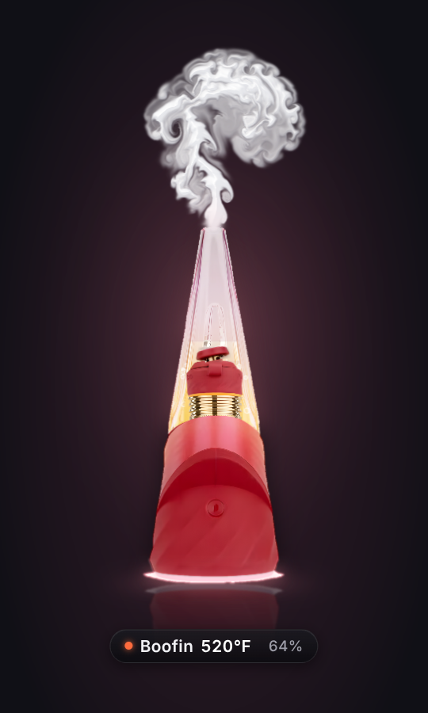
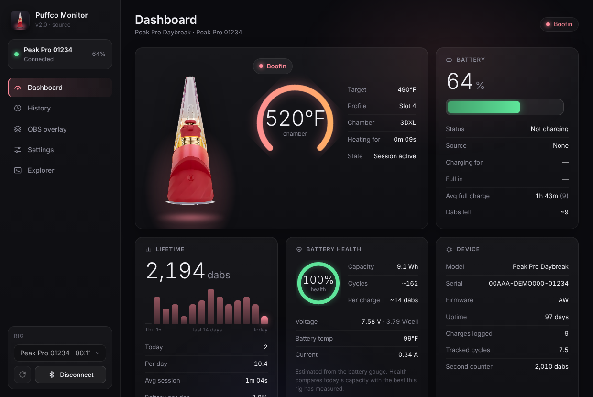
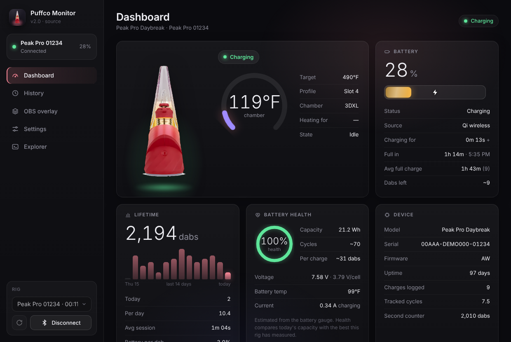
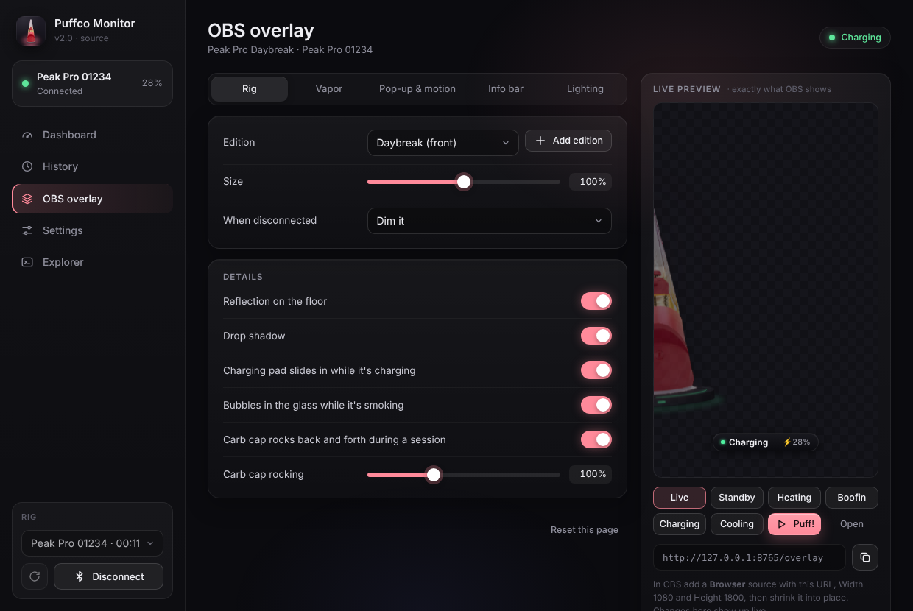
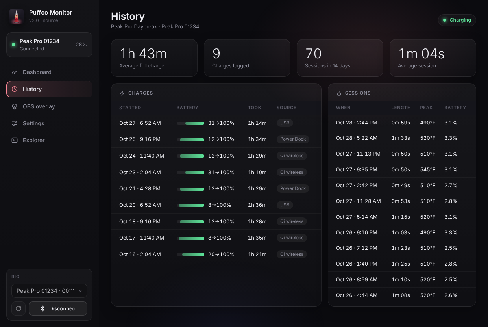

<p align="center">
  
</p>

<h1 align="center">Puffco Monitor</h1>

<p align="center">
  A Windows companion app for the <b>Puffco Peak Pro</b> that reads everything the phone app shows (and a few things it doesn't) over Bluetooth,<br>
  plus an <b>OBS overlay</b> of your rig that heats up, glows and smokes along with the real one.
</p>



## What it does

**The app**
- **Live dashboard:** chamber temperature, target temp, heat profile, how long it's been heating, and the current state.
- **Battery:** charge level, charger type (USB, Qi wireless or Power Dock), how long it's been charging, when it'll be full, your average full-charge time and roughly how many dabs are left.
- **Battery health:** estimated capacity, charge cycles, dabs per charge, voltage, battery temperature and current.
- **History:** every charge and session it sees, plus lifetime dabs and a 14-day chart.
- **Stays connected:** reconnects on its own and can notify you when the rig is ready, fully charged or running low.
- **Background running:** lives in the system tray, starts with Windows if you want, and only runs one copy at a time.
- **Explorer:** read any raw value off the rig, for the curious.

**The OBS overlay**
- Your rig, built from a real photo, with switchable editions.
- Shows standby, heating, and the session (labeled "Boofin" by default). Smoke follows an adjustable breathing rhythm: smoke on the inhale, a clear exhale, then a pause.
- A charging pad slides in while it charges. The carb cap rocks during a session, bubbles rise in the glass, and there's a floor reflection and glow.
- **Pop-up mode:** the rig swoops in when something changes and stays up through the whole heat-up and session. The info bar can stay on screen by itself.
- Everything is adjustable from the app with a live preview, including sizes, timings, colors, wording, animations and when it hides.

| | |
|---|---|
|  |  |
|  | |

## Getting started

1. Download **PuffcoMonitor.exe** from the [Releases](../../releases/latest) page and put it in its own folder. It saves its data next to itself.
2. Run it. Windows SmartScreen may warn about an unsigned app: click **More info**, then **Run anyway**.
3. **Close the Puffco phone app** (or turn off your phone's Bluetooth). The rig only accepts one connection at a time.
4. Click **Scan** and pick your rig, then **Connect**.

Closing the window keeps it running in the tray. Right-click the tray icon to connect or disconnect, copy the overlay URL, toggle **Start with Windows**, or quit.

The window uses Microsoft Edge WebView2, which comes with Windows 11 and most Windows 10 installs. Without it, the app opens in an Edge app window instead.

## OBS overlay setup

1. In OBS, add a **Browser** source.
2. Set the URL to `http://127.0.0.1:8765/overlay`.
3. Set the width to **1080** and the height to **1800**, then shrink the source into place. It's rendered at 2× so it stays sharp.

Puffco Monitor has to be running for the overlay to update. Changes you make on the app's **OBS overlay** page show up live.

## Adding your own edition

On the **OBS overlay** page, click **Add edition** and drop in a photo of your rig. It works best with a straight-on shot from the side or front, on a plain white background. The app cuts the rig out and finds the glass, the light band and the carb cap automatically.

You can also run it from the command line:

```
python add_rig.py "photo.png" "Edition Name"
```

Each edition is a folder in `rigs/`. If the smoke or glow lands in the wrong spot, adjust the positions in its `rig.json`.

## Running from source

You'll need Windows 10 or 11 and Python 3.10 or newer.

```
pip install -r requirements.txt
pythonw puffco_monitor.py
```

You can also double-click **Start Puffco Monitor.bat**, which installs anything missing first.

To build the exe yourself, double-click **Build Puffco Monitor.bat**. It runs PyInstaller with `puffco_monitor.spec`.

Command-line options:
- `--minimized` starts in the tray.
- `--startup` is what the Windows startup entry uses.
- `--selftest` checks that every bundled piece loads, then writes `selftest.txt`.

## Your data

Everything stays on your PC, in the same folder as the app:

| File | What's in it |
|---|---|
| `puffco_data.json` | Your rig's name and Bluetooth address, charge and session history, and all settings |
| `puffco_monitor.log` | Errors, for troubleshooting |
| `rigs/` | Overlay editions |

The app only talks to your rig and to `127.0.0.1`. The overlay server listens on port 8765, or the next free port up to 8770.

## How it works

The Peak Pro speaks Puffco's BLE protocol. The app unlocks a session with the rig's seed/key handshake and then only sends **read** commands, so it never changes settings on the device. The UI is a local web page (`app.html`) shown in a native window, and the overlay (`overlay.html`) is a WebGL page that OBS loads from the same local server.

## Disclaimer

This is an unofficial fan project. It is not affiliated with, endorsed by or supported by Puffco. "Puffco" and "Peak Pro" are trademarks of their respective owner. Use at your own risk.
